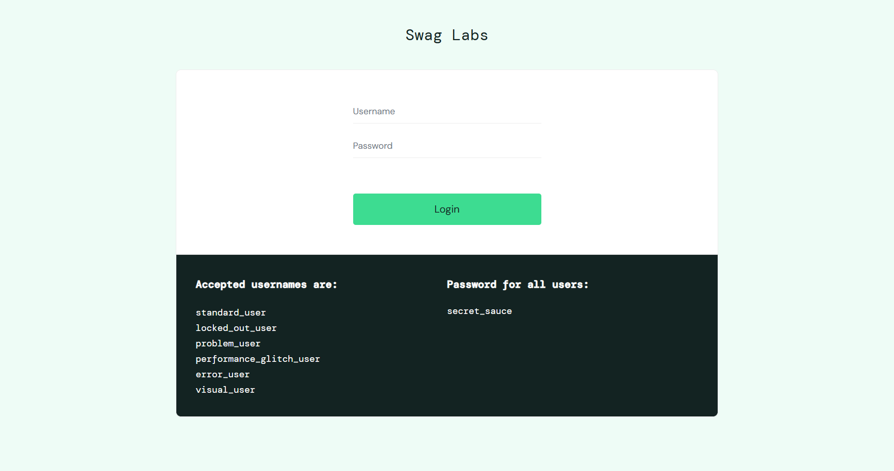
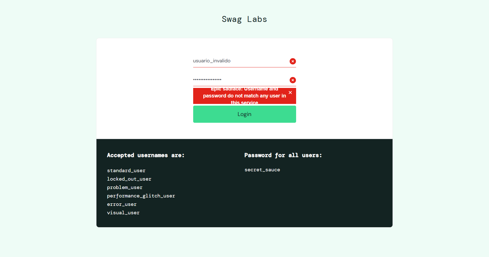
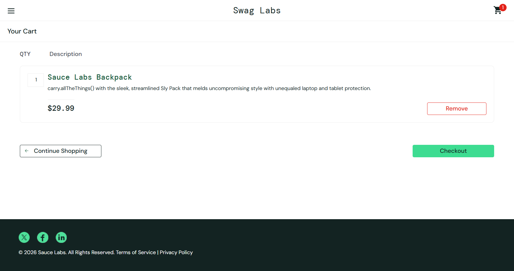
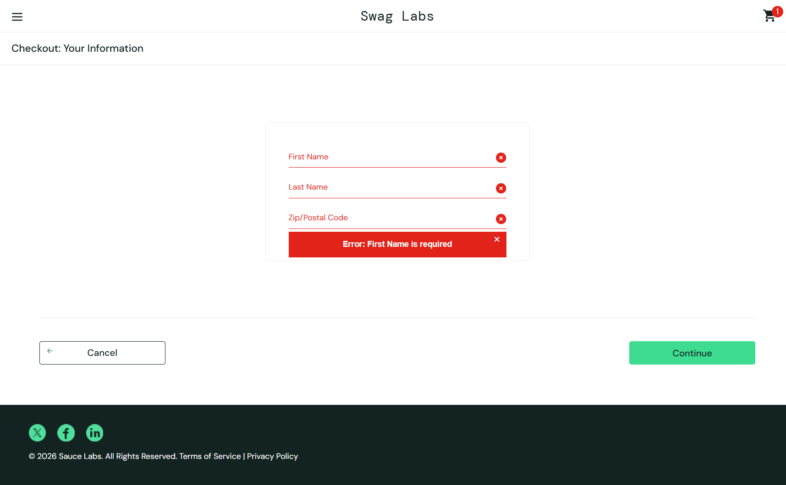
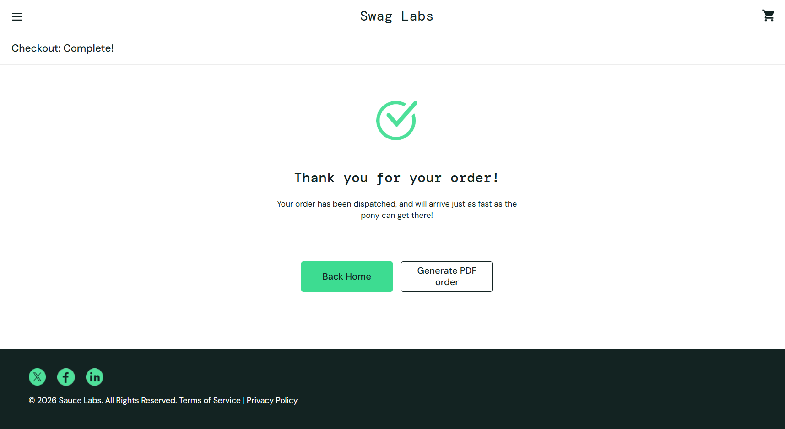

# Pruebas de caja negra — SauceDemo (Swag Labs)

**URL probada:** https://www.saucedemo.com/  
**Técnica:** caja negra (plantilla de casos de prueba y ejecución de la materia)

## Resumen de casos

| ID | Título | Prioridad | Tipo | Estado |
| --- | --- | --- | --- | --- |
| [TC-001](#tc-001--inicio-de-sesión-exitoso-con-usuario-válido) | Inicio de sesión exitoso con usuario válido | Alta | Funcional | PASS |
| [TC-002](#tc-002--inicio-de-sesión-con-credenciales-inválidas) | Inicio de sesión con credenciales inválidas | Alta | Negativa | PASS |
| [TC-003](#tc-003--agregar-un-producto-al-carrito) | Agregar un producto al carrito | Alta | Funcional | PASS |
| [TC-004](#tc-004--validación-de-campos-obligatorios-en-el-checkout) | Validación de campos obligatorios en el checkout | Media | Negativa | PASS |
| [TC-005](#tc-005--completar-una-compra-de-extremo-a-extremo) | Completar una compra de extremo a extremo | Alta | Funcional | PASS |

> Los cinco casos resultaron **PASS**; no hay defectos reproducibles (ver [`../bugs/bugs_encontrados.md`](../bugs/bugs_encontrados.md)).

## Entorno y datos de prueba

| Campo | Valor |
| --- | --- |
| Aplicación | Swag Labs (SauceDemo) |
| URL | https://www.saucedemo.com/ |
| Usuario de prueba | `standard_user` |
| Contraseña | `secret_sauce` |
| Navegador y versión | [Completar] |
| Sistema operativo | [Completar] |
| Dispositivo | [Completar] |

---

## TC-001 · Inicio de sesión exitoso con usuario válido

### Parte 1 · Diseño del caso

| ID | Prioridad | Tipo | Módulo | Ambiente |
| --- | --- | --- | --- | --- |
| TC-001 | Alta | Funcional | Inicio de sesión | QA (sitio de demostración público) |

**Objetivo:** Validar que un usuario con credenciales válidas accede a la página del catálogo de productos.

**Precondiciones**

- **Estado inicial:** Navegador web con acceso a Internet y JavaScript habilitado; sin sesión iniciada.
- **Usuario / permisos:** Usuario de demostración estándar, sin permisos especiales.
- **Configuración:** Ninguna configuración adicional.

**Datos de prueba**

- **Dato:** Credenciales de acceso
- **Valor:** Usuario: `standard_user` │ Contraseña: `secret_sauce`
- **Origen:** Preparado (usuarios de demostración publicados en la página de login)
- **Observación:** Usuario estándar, sin comportamientos especiales.

**Pasos y resultados esperados**

| # | Paso / acción | Dato utilizado | Resultado esperado |
| --- | --- | --- | --- |
| 1 | Abrir la URL de la aplicación en el navegador. | https://www.saucedemo.com/ | Se muestra la página de login con los campos Username y Password y el botón Login. |
| 2 | Escribir el nombre de usuario en el campo Username. | standard_user | El campo muestra el texto ingresado. |
| 3 | Escribir la contraseña en el campo Password. | secret_sauce | El texto de la contraseña aparece enmascarado. |
| 4 | Hacer clic en el botón Login. | N/A | Se redirige a la página de inventario (/inventory.html) con el título Products y la lista de productos. |

**Criterio de éxito:** El usuario accede al catálogo con el título Products visible y sin mensajes de error.

### Parte 2 · Ejecución

| ID | Ejecutado por | Fecha | Hora | Ambiente | Versión |
| --- | --- | --- | --- | --- | --- |
| TC-001 | [Nombre del tester] | [dd/mm/aaaa] | [hh:mm] | QA | Sin versión visible (sitio en línea) |

**Resultado de la ejecución:** ☒ PASS · ☐ FAIL · ☐ BLOCKED · ☐ NOT RUN

**Resultado observado:** Se mostró la página de login de Swag Labs con los campos Username y Password, el botón Login y la lista de usuarios de demostración. El acceso con las credenciales válidas fue exitoso y no apareció ningún mensaje de error; el acceso se confirma porque las pruebas siguientes se ejecutaron con la sesión iniciada.

**Comparación:** Coincide con lo esperado: el usuario con credenciales válidas accede a la aplicación.

**Registro de ejecución por paso**

| # | Paso ejecutado | Resultado observado | Estado | Observación |
| --- | --- | --- | --- | --- |
| 1 | Abrir la URL de la aplicación en el navegador. | Se mostró la página de login con los campos Username, Password y el botón Login. | PASS | Ver Figura 1. |
| 2 | Escribir el nombre de usuario en el campo Username. | El campo Username aceptó el texto ingresado. | PASS | Sin observaciones. |
| 3 | Escribir la contraseña en el campo Password. | La contraseña se ingresó de forma enmascarada. | PASS | Sin observaciones. |
| 4 | Hacer clic en el botón Login. | Se accedió a la aplicación sin mensajes de error. | PASS | Acceso confirmado por la sesión iniciada en los casos TC-003 a TC-005. |

**Evidencia**

- **Tipo:** Captura
- **Archivo:** `evidencia_TC001_01.png`
- **Descripción:** Muestra la página de login de Swag Labs (estado inicial de la prueba) con los campos Username y Password, el botón Login y los usuarios de demostración.

*Figura 1. Página de login de SauceDemo (TC-001).*

**Si el resultado es FAIL:** N/A. El caso resultó PASS. · **Referencia del defecto:** N/A

**Observaciones de ejecución:** La captura corresponde a la pantalla de inicio de la prueba. El resultado del acceso se verifica con las sesiones iniciadas de los casos TC-003 a TC-005.

---

## TC-002 · Inicio de sesión con credenciales inválidas

### Parte 1 · Diseño del caso

| ID | Prioridad | Tipo | Módulo | Ambiente |
| --- | --- | --- | --- | --- |
| TC-002 | Alta | Negativa | Inicio de sesión | QA (sitio de demostración público) |

**Objetivo:** Validar que el sistema rechaza credenciales incorrectas, muestra un mensaje de error y no permite el acceso.

**Precondiciones**

- **Estado inicial:** Navegador web con acceso a Internet; sin sesión iniciada.
- **Usuario / permisos:** Usuario anónimo (sin autenticar).
- **Configuración:** Ninguna configuración adicional.

**Datos de prueba**

- **Dato:** Credenciales de acceso
- **Valor:** Usuario: `usuario_invalido` │ Contraseña: `contraseña inválida`
- **Origen:** Generado por el tester
- **Observación:** Usuario inexistente con contraseña incorrecta.

**Pasos y resultados esperados**

| # | Paso / acción | Dato utilizado | Resultado esperado |
| --- | --- | --- | --- |
| 1 | Abrir la URL de la aplicación en el navegador. | https://www.saucedemo.com/ | Se muestra la página de login. |
| 2 | Escribir un nombre de usuario inexistente en el campo Username. | usuario_invalido | El campo muestra el texto ingresado. |
| 3 | Escribir una contraseña inválida en el campo Password. | Contraseña inválida | El texto de la contraseña aparece enmascarado. |
| 4 | Hacer clic en el botón Login. | N/A | Se muestra el mensaje de error: Epic sadface: Username and password do not match any user in this service. |
| 5 | Verificar la página actual. | N/A | El usuario permanece en la página de login y no accede a /inventory.html. |

**Criterio de éxito:** Se muestra el mensaje de error de credenciales y no se concede acceso al catálogo.

### Parte 2 · Ejecución

| ID | Ejecutado por | Fecha | Hora | Ambiente | Versión |
| --- | --- | --- | --- | --- | --- |
| TC-002 | [Nombre del tester] | [dd/mm/aaaa] | [hh:mm] | QA | Sin versión visible (sitio en línea) |

**Resultado de la ejecución:** ☒ PASS · ☐ FAIL · ☐ BLOCKED · ☐ NOT RUN

**Resultado observado:** Con el usuario usuario_invalido y una contraseña inválida, al presionar Login se mostró el mensaje Epic sadface: Username and password do not match any user in this service en un recuadro rojo, con los campos Username y Password marcados con un ícono de error. El usuario permaneció en la página de login. El texto del mensaje se ve parcialmente recortado dentro del recuadro.

**Comparación:** Coincide con lo esperado: se muestra el mensaje de error de credenciales y no se concede el acceso.

**Registro de ejecución por paso**

| # | Paso ejecutado | Resultado observado | Estado | Observación |
| --- | --- | --- | --- | --- |
| 1 | Abrir la URL de la aplicación en el navegador. | Se mostró la página de login. | PASS | Sin observaciones. |
| 2 | Escribir un nombre de usuario inexistente en el campo Username. | Se ingresó usuario_invalido en el campo Username. | PASS | Ver Figura 2. |
| 3 | Escribir una contraseña inválida en el campo Password. | La contraseña se ingresó de forma enmascarada. | PASS | Sin observaciones. |
| 4 | Hacer clic en el botón Login. | Se mostró el mensaje Epic sadface: Username and password do not match any user in this service. | PASS | El texto aparece parcialmente recortado en el recuadro. |
| 5 | Verificar la página actual. | El usuario permaneció en la página de login y no accedió al inventario. | PASS | Sin observaciones. |

**Evidencia**

- **Tipo:** Captura
- **Archivo:** `evidencia_TC002_01.png`
- **Descripción:** Muestra la página de login con el usuario usuario_invalido, la contraseña enmascarada y el mensaje de error de credenciales.

*Figura 2. Mensaje de error con credenciales inválidas (TC-002).*

**Si el resultado es FAIL:** N/A. El caso resultó PASS. · **Referencia del defecto:** N/A

**Observaciones de ejecución:** El texto del mensaje de error se ve parcialmente recortado dentro del recuadro rojo. No afecta el resultado funcional de la prueba.

---

## TC-003 · Agregar un producto al carrito

### Parte 1 · Diseño del caso

| ID | Prioridad | Tipo | Módulo | Ambiente |
| --- | --- | --- | --- | --- |
| TC-003 | Alta | Funcional | Catálogo y carrito | QA (sitio de demostración público) |

**Objetivo:** Validar que un producto del catálogo puede agregarse al carrito y que el carrito refleja el producto, la cantidad y el precio correctos.

**Precondiciones**

- **Estado inicial:** Sesión iniciada en la aplicación y carrito vacío.
- **Usuario / permisos:** Usuario de demostración estándar.
- **Configuración:** Ninguna configuración adicional.

**Datos de prueba**

- **Dato:** Credenciales y producto
- **Valor:** Usuario: `standard_user` │ Contraseña: `secret_sauce` │ Producto: Sauce Labs Backpack ($29.99)
- **Origen:** Preparado (catálogo de la aplicación)
- **Observación:** El carrito debe estar vacío antes de iniciar.

**Pasos y resultados esperados**

| # | Paso / acción | Dato utilizado | Resultado esperado |
| --- | --- | --- | --- |
| 1 | Iniciar sesión con las credenciales de prueba. | standard_user / secret_sauce | Se muestra la página de inventario. |
| 2 | Agregar el producto al carrito con el botón Add to cart. | Sauce Labs Backpack | El ícono del carrito muestra el contador 1. |
| 3 | Hacer clic en el ícono del carrito. | N/A | Se muestra la página Your Cart. |
| 4 | Verificar el contenido del carrito. | N/A | Aparece Sauce Labs Backpack con cantidad 1, precio $29.99 y el botón Remove. |

**Criterio de éxito:** El producto aparece en el carrito con cantidad 1 y precio correcto, y el contador del carrito indica 1.

### Parte 2 · Ejecución

| ID | Ejecutado por | Fecha | Hora | Ambiente | Versión |
| --- | --- | --- | --- | --- | --- |
| TC-003 | [Nombre del tester] | [dd/mm/aaaa] | [hh:mm] | QA | Sin versión visible (sitio en línea) |

**Resultado de la ejecución:** ☒ PASS · ☐ FAIL · ☐ BLOCKED · ☐ NOT RUN

**Resultado observado:** Tras iniciar sesión y agregar el producto Sauce Labs Backpack, el ícono del carrito mostró el contador 1. En la página Your Cart apareció Sauce Labs Backpack con cantidad 1 y precio $29.99, junto con los botones Remove, Continue Shopping y Checkout.

**Comparación:** Coincide con lo esperado: el producto aparece en el carrito con la cantidad y el precio correctos.

**Registro de ejecución por paso**

| # | Paso ejecutado | Resultado observado | Estado | Observación |
| --- | --- | --- | --- | --- |
| 1 | Iniciar sesión con las credenciales de prueba. | Se accedió a la página de inventario. | PASS | Sesión iniciada. |
| 2 | Agregar el producto al carrito con el botón Add to cart. | El ícono del carrito mostró el contador 1. | PASS | Ver Figura 3. |
| 3 | Hacer clic en el ícono del carrito. | Se mostró la página Your Cart. | PASS | Sin observaciones. |
| 4 | Verificar el contenido del carrito. | Aparecieron Sauce Labs Backpack, cantidad 1, precio $29.99 y el botón Remove. | PASS | Sin observaciones. |

**Evidencia**

- **Tipo:** Captura
- **Archivo:** `evidencia_TC003_01.png`
- **Descripción:** Muestra la página Your Cart con Sauce Labs Backpack (cantidad 1, $29.99) y el contador 1 en el ícono del carrito.

*Figura 3. Página Your Cart con el producto agregado (TC-003).*

**Si el resultado es FAIL:** N/A. El caso resultó PASS. · **Referencia del defecto:** N/A

**Observaciones de ejecución:** Sin observaciones adicionales.

---

## TC-004 · Validación de campos obligatorios en el checkout

### Parte 1 · Diseño del caso

| ID | Prioridad | Tipo | Módulo | Ambiente |
| --- | --- | --- | --- | --- |
| TC-004 | Media | Negativa | Compra (checkout) | QA (sitio de demostración público) |

**Objetivo:** Validar que el formulario de información de checkout exige los campos obligatorios y muestra un mensaje de error cuando se intenta continuar con el formulario vacío.

**Precondiciones**

- **Estado inicial:** Sesión iniciada y el producto Sauce Labs Backpack agregado al carrito.
- **Usuario / permisos:** Usuario de demostración estándar.
- **Configuración:** Ninguna configuración adicional.

**Datos de prueba**

- **Dato:** Datos del formulario de checkout
- **Valor:** First Name, Last Name y Zip/Postal Code vacíos
- **Origen:** Preparado por el tester
- **Observación:** Se valida el primer mensaje de error que muestra el formulario.

**Pasos y resultados esperados**

| # | Paso / acción | Dato utilizado | Resultado esperado |
| --- | --- | --- | --- |
| 1 | Abrir el carrito y hacer clic en Checkout. | N/A | Se muestra Checkout: Your Information con los campos First Name, Last Name y Zip/Postal Code. |
| 2 | Dejar los tres campos vacíos y hacer clic en Continue. | Campos vacíos | Se muestra el mensaje Error: First Name is required. |
| 3 | Verificar la página actual. | N/A | El usuario permanece en Checkout: Your Information y no avanza al resumen. |

**Criterio de éxito:** El sistema muestra el mensaje de error de campo obligatorio y no permite continuar con el formulario vacío.

### Parte 2 · Ejecución

| ID | Ejecutado por | Fecha | Hora | Ambiente | Versión |
| --- | --- | --- | --- | --- | --- |
| TC-004 | [Nombre del tester] | [dd/mm/aaaa] | [hh:mm] | QA | Sin versión visible (sitio en línea) |

**Resultado de la ejecución:** ☒ PASS · ☐ FAIL · ☐ BLOCKED · ☐ NOT RUN

**Resultado observado:** Al presionar Continue con First Name, Last Name y Zip/Postal Code vacíos, se mostró el mensaje Error: First Name is required en un recuadro rojo, con los tres campos resaltados en rojo. El sistema no avanzó y se mantuvo en Checkout: Your Information; el carrito conservó el contador 1.

**Comparación:** Coincide con lo esperado: se muestra el mensaje de campo obligatorio y no se permite continuar.

**Registro de ejecución por paso**

| # | Paso ejecutado | Resultado observado | Estado | Observación |
| --- | --- | --- | --- | --- |
| 1 | Abrir el carrito y hacer clic en Checkout. | Se mostró Checkout: Your Information con los campos First Name, Last Name y Zip/Postal Code. | PASS | Sin observaciones. |
| 2 | Dejar los tres campos vacíos y hacer clic en Continue. | Se mostró el mensaje Error: First Name is required. | PASS | Ver Figura 4. |
| 3 | Verificar la página actual. | El usuario permaneció en Checkout: Your Information. | PASS | Sin observaciones. |

**Evidencia**

- **Tipo:** Captura
- **Archivo:** `evidencia_TC004_01.png`
- **Descripción:** Muestra Checkout: Your Information con los tres campos resaltados y el mensaje Error: First Name is required.

*Figura 4. Validación de campos obligatorios en el checkout (TC-004).*

**Si el resultado es FAIL:** N/A. El caso resultó PASS. · **Referencia del defecto:** N/A

**Observaciones de ejecución:** El campo de código postal se llama Zip/Postal Code en la interfaz.

---

## TC-005 · Completar una compra de extremo a extremo

### Parte 1 · Diseño del caso

| ID | Prioridad | Tipo | Módulo | Ambiente |
| --- | --- | --- | --- | --- |
| TC-005 | Alta | Funcional | Compra (checkout) | QA (sitio de demostración público) |

**Objetivo:** Validar que un usuario puede completar el proceso de compra con datos válidos y recibir la confirmación del pedido.

**Precondiciones**

- **Estado inicial:** Sesión iniciada y el producto Sauce Labs Backpack agregado al carrito.
- **Usuario / permisos:** Usuario de demostración estándar.
- **Configuración:** Ninguna configuración adicional.

**Datos de prueba**

- **Dato:** Datos del formulario de checkout
- **Valor:** First Name: `Juan` │ Last Name: `Perez` │ Postal Code: `0000`
- **Origen:** Generado por el tester
- **Observación:** Compra de un solo producto ($29.99).

**Pasos y resultados esperados**

| # | Paso / acción | Dato utilizado | Resultado esperado |
| --- | --- | --- | --- |
| 1 | Abrir el carrito y hacer clic en Checkout. | N/A | Se muestra Checkout: Your Information. |
| 2 | Completar el formulario y hacer clic en Continue. | Juan / Perez / 0000 | Se muestra Checkout: Overview con el producto y el resumen de pago. |
| 3 | Hacer clic en Finish. | N/A | Se muestra Checkout: Complete! con el mensaje Thank you for your order!. |

**Criterio de éxito:** La compra se completa, se muestra el mensaje de confirmación y el carrito queda sin productos.

### Parte 2 · Ejecución

| ID | Ejecutado por | Fecha | Hora | Ambiente | Versión |
| --- | --- | --- | --- | --- | --- |
| TC-005 | [Nombre del tester] | [dd/mm/aaaa] | [hh:mm] | QA | Sin versión visible (sitio en línea) |

**Resultado de la ejecución:** ☒ PASS · ☐ FAIL · ☐ BLOCKED · ☐ NOT RUN

**Resultado observado:** Se completó el proceso de compra y se mostró la pantalla Checkout: Complete! con el ícono de confirmación, el mensaje Thank you for your order! y el texto de despacho del pedido, junto con los botones Back Home y Generate PDF order. El ícono del carrito quedó sin contador.

**Comparación:** Coincide con lo esperado: la compra se completa y se muestra la confirmación del pedido.

**Registro de ejecución por paso**

| # | Paso ejecutado | Resultado observado | Estado | Observación |
| --- | --- | --- | --- | --- |
| 1 | Abrir el carrito y hacer clic en Checkout. | Se mostró Checkout: Your Information. | PASS | Sin observaciones. |
| 2 | Completar el formulario y hacer clic en Continue. | Se mostró Checkout: Overview con el resumen de la compra. | PASS | Sin observaciones. |
| 3 | Hacer clic en Finish. | Se mostró Checkout: Complete! con el mensaje Thank you for your order!. | PASS | Ver Figura 5. |

**Evidencia**

- **Tipo:** Captura
- **Archivo:** `evidencia_TC005_01.png`
- **Descripción:** Muestra la pantalla Checkout: Complete! con el mensaje Thank you for your order! y el carrito sin contador.

*Figura 5. Confirmación de la compra (TC-005).*

**Si el resultado es FAIL:** N/A. El caso resultó PASS. · **Referencia del defecto:** N/A

**Observaciones de ejecución:** Sin observaciones adicionales.
